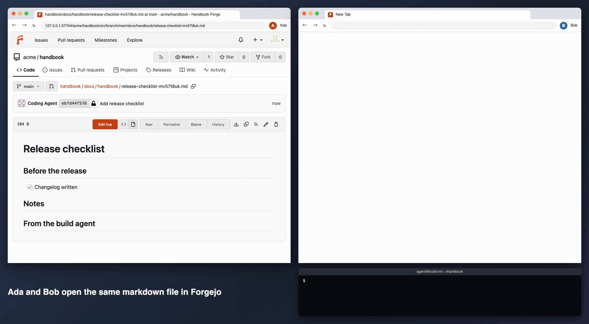

# demo-forgejo-collaborative-editing

A small demo: two people editing the same markdown file live inside Forgejo's normal web
interface, with the text ending up as ordinary git commits. Forgejo itself is not forked or
patched.



(Sharper version: [docs/demo.mp4](docs/demo.mp4). The clip is real time. The pages, the sync and
the git push are real; the browsers run headless and scripted, so the window frames and mouse
pointers are drawn around them.)

## Read this first

This is a demo of what could be done, not something to run for a team. It was put together to
see whether the idea works at all. It has run on one laptop, against one Forgejo version
(16.0.5), with made-up accounts. Nobody has used it for real work. There is no plan behind it,
no roadmap and no support. If it is useful as a starting point or as an argument in a
discussion, good.

## What happens in the clip

- Ada and Bob open the same file page in Forgejo and each press "Edit live".
- They type at the same time and see each other's text and carets.
- A few seconds after they stop, the text is a commit on `main`, authored by whoever typed
  first, with the other as co-author.
- Something else (here a script standing in for a coding agent) runs a plain `git push`. The
  new line shows up in both open editors without a reload.
- Forgejo's history page shows all of it as normal commits. Nothing is stored outside git.

## How it hooks into Forgejo

The only file added to Forgejo is `custom/templates/custom/footer.tmpl`, with one line:

```html
<script type="module" src="{{AppSubUrl}}/live/embed.js"></script>
```

The rest uses things Forgejo already has:

- the OAuth2 provider, so people sign in with their Forgejo account
- the API, to ask what a person may do in a repository
- git over HTTP, so every commit is pushed as the person who typed it
- a push webhook, to notice commits from elsewhere
- optional hook files in `hooks/pre-receive.d/` and `hooks/post-receive.d/`, to make that fast
  and to save unsaved typing before someone else's push lands on the same file

A separate small Node service does the live part (CodeMirror 6, Yjs, and a bridge between the
shared text and git). A reverse proxy puts it under `/live/` on the same address as Forgejo.

## What is in here

| Folder | What |
| --- | --- |
| `forgejo-live/` | Forgejo configuration, the template line, a small proxy, start and stop scripts, browser tests. Details in [forgejo-live/README.md](forgejo-live/README.md) |
| `yjs-bridge/` | the editor service. Details in [yjs-bridge/README.md](yjs-bridge/README.md) |
| `docs/` | the clip |

## Trying it

Needs Node 24 or newer, pnpm, git, and a Forgejo binary for your machine. Forgejo publishes
Linux binaries; on macOS it has to be built from source.

```sh
(cd yjs-bridge && pnpm install)
(cd forgejo-live && pnpm install)

export FORGEJO_BIN=/path/to/forgejo
export FORGEJO_LIVE_HOME=/path/to/an/empty/folder
forgejo-live/scripts/up.sh      # prints the address and the made-up accounts
forgejo-live/scripts/down.sh
```

Everything it creates (database, repositories, logs) goes into `FORGEJO_LIVE_HOME`. The clip is
made with `node forgejo-live/scripts/record-demo.mjs <output folder>` against the running stack
(needs ffmpeg).

## Things it does not do

- Only the branch `main`. If `main` does not allow direct pushes, it cannot save. No pull
  requests.
- The "Edit live" button is placed by looking at Forgejo's page markup, so a Forgejo update can
  make it disappear.
- Forgejo's own edit form is still there. Saving from it while someone is live on the same file
  gets refused with a message written for git users.
- Signing out of Forgejo does not close an open editor.
- Only tried on macOS with SQLite and git over HTTP. Linux, Docker, SSH pushes and Gitea are
  untested.
- One of the crash tests failed once in five runs. No text was lost, but the cause is not known.

More of these are listed at the end of the two READMEs in the folders.

## License

MIT, see [LICENSE](LICENSE).
